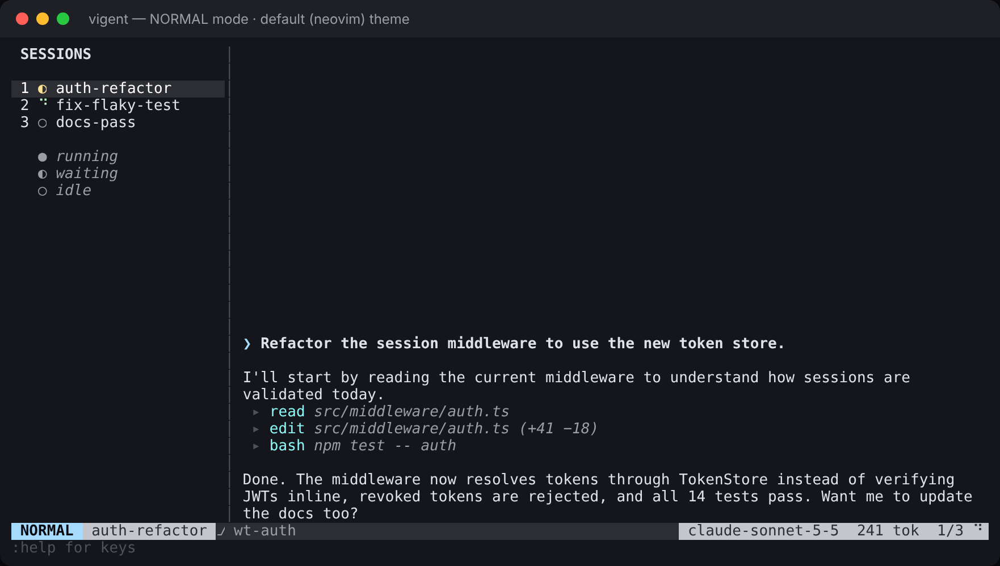
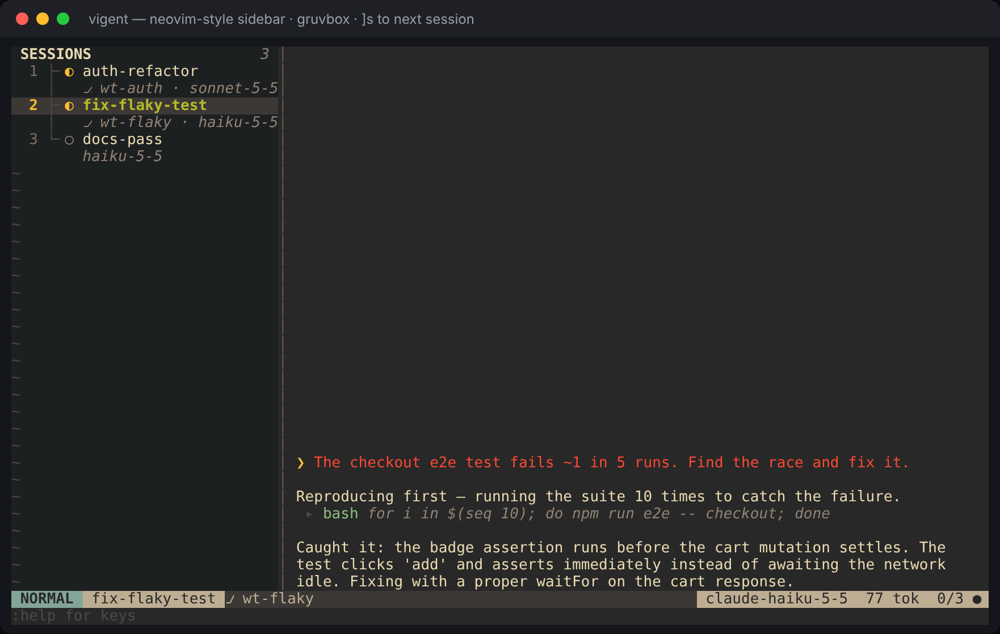
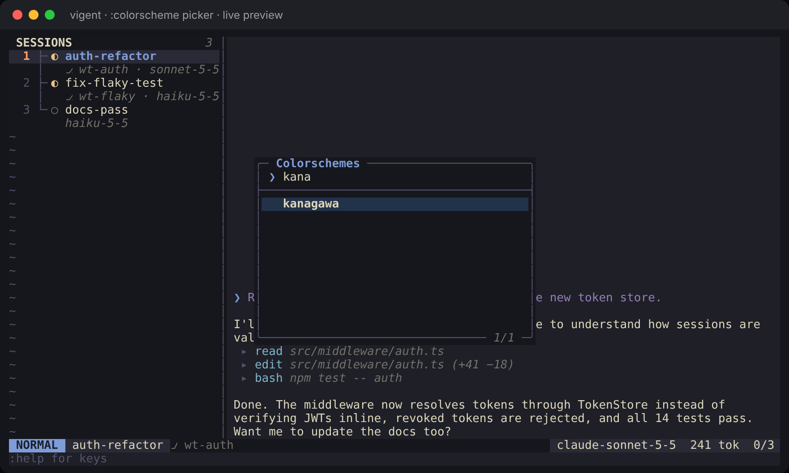
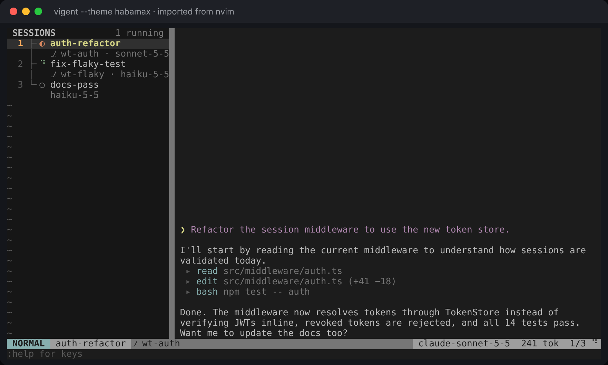
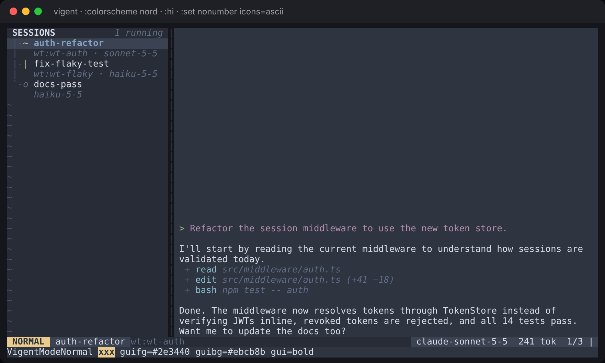

# vigent

A vim-style, lightweight terminal app for running several coding agents at once, built on the [pi](https://github.com/badlogic/pi-mono) engine.





## Quick start

```bash
npm install
npm run build
npm run demo      # scripted sessions, no API key needed
npm test          # build and run the test suite
```

With a provider key set (`ANTHROPIC_API_KEY`, `OPENAI_API_KEY`, `GEMINI_API_KEY`), `npm start` runs a real pi agent session instead of the demo.

## Keys

| Mode | Key | Action |
|---|---|---|
| NORMAL | `i` / `a` / `o` | Enter INSERT and type a prompt for the focused agent |
| NORMAL | `j` `k` `gg` `G` `Ctrl-d` `Ctrl-u` | Scroll the transcript |
| NORMAL | `]s` `[s` `1`–`9` `Ctrl-^` | Switch sessions |
| NORMAL | `za` `zR` `zM` | Toggle, open or close tool-output folds |
| NORMAL | `/pattern` `n` `N` | Search the transcript |
| INSERT | `Enter` / `Esc` | Send the prompt / back to NORMAL |

Ex commands: `:new <name>`, `:kill`, `:colorscheme [name]`, `:hi`, `:set`, `:model <id>`, `:help`, `:q`.

## Themes

vigent speaks Neovim's highlight groups (`Normal`, `StatusLine`, `CursorLine`, …), so your vim or Neovim theme carries straight over.

```bash
vigent theme import                 # whatever colorscheme your nvim/vim config uses
vigent theme import kanagawa        # any colorscheme your editor can load (plugins included)
vigent theme import ./molokai.vim   # a .vim file, no editor needed
vigent theme new mine --from nord   # start your own theme
```

Inside vigent, `:colorscheme` opens a picker with live preview. `:hi Group guifg=… guibg=…` changes any color on the spot, and `:set` toggles UI options. To keep changes, put them in `~/.config/vigent/config.toml` (`vigent config init` writes a starter file):

```toml
theme = "tokyonight"

[ui]
sidebar_width = 34
icons = "unicode"      # or "ascii"

[highlights]           # applied on top of any theme
Normal = { bg = "NONE" }
CursorLine = "guibg=#2a2f3a"
```

Built in: `default` (Neovim's default look), `gruvbox`, `tokyonight`, `catppuccin`, `catppuccin-latte`, `nord`, `rose-pine`, `kanagawa`.







The full guide covers importing, theme files, palettes, every option and every highlight group: **[docs/themes.md](docs/themes.md)**.

## Layout

```
src/
  cli.ts             entry point, flags, `theme` and `config` subcommands
  app.ts             the modal TUI (modes, keys, sidebar, transcript, statusline, cmdline)
  picker.ts          floating :colorscheme picker
  theme.ts           highlight-group engine: resolution, overrides, theme files
  builtin-themes.ts  built-in themes
  palette.ts         builds a full theme from a small palette
  import.ts          imports colorschemes from nvim / vim (headless) or .vim files
  vimcolors.ts       :highlight syntax and the static .vim colorscheme reader
  color.ts           hex math, xterm-256 colors, vim color names
  config.ts          config.toml, ui options and :set
  session.ts         Session model; PiSession (real engine) and DemoSession
  demo.ts            scripted demo sessions
test/                node:test suites (npm test)
```

See [DESIGN.md](DESIGN.md) for the full plan and milestones.
