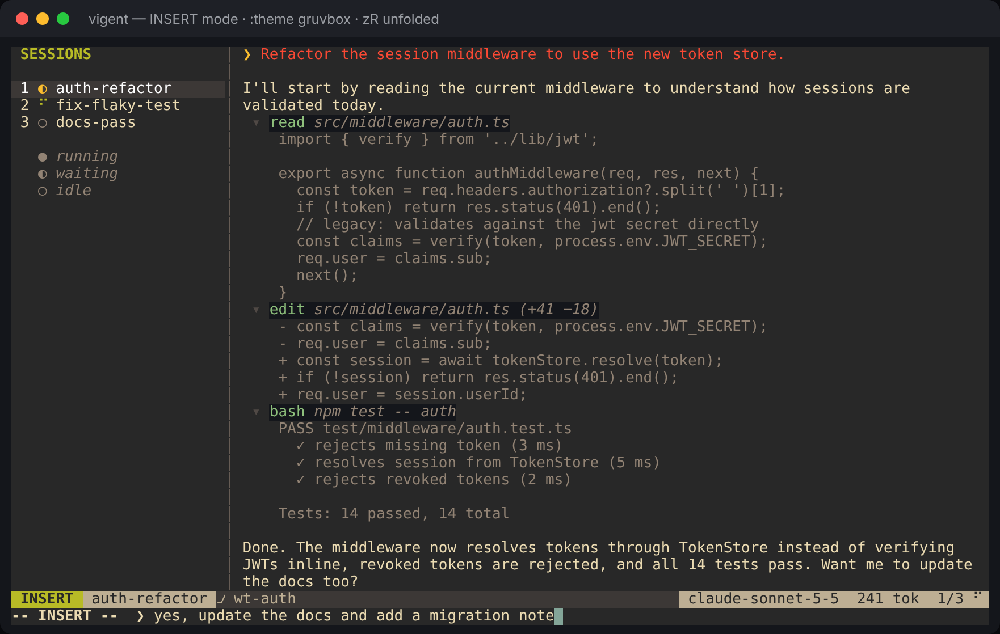

# vigent

A vim-style, lightweight terminal app for running several coding agents at once, built on the [pi](https://github.com/badlogic/pi-mono) engine.




## Quick start

```bash
npm install
npm run build
npm run demo      # scripted sessions, no API key needed
```

With a provider key set (`ANTHROPIC_API_KEY`, `OPENAI_API_KEY`, `GEMINI_API_KEY`), `npm start` runs a real pi agent session instead of the demo.

## Keys

| Mode | Key | Action |
|---|---|---|
| NORMAL | `i` / `a` / `o` | Enter INSERT and type a prompt for the focused agent |
| NORMAL | `j` `k` `gg` `G` `Ctrl-d` `Ctrl-u` | Scroll the transcript |
| NORMAL | `]s` `[s` `1`–`9` `Ctrl-^` | Switch sessions |
| NORMAL | `za` `zR` `zM` | Toggle, open or close tool-output folds |
| NORMAL | `/pattern` `n` `N` | Search the transcript |
| INSERT | `Enter` / `Esc` | Send the prompt / back to NORMAL |

Ex commands: `:new <name>`, `:kill`, `:theme <name>`, `:model <id>`, `:help`, `:q`.

## Themes

Themes use **Neovim highlight group names** (`Normal`, `StatusLine`, `Visual`, `Comment`, `DiffAdd`, …), so any vim or Neovim colorscheme maps onto vigent directly.

- `default`: Neovim's built-in dark colorscheme (the default look)
- `gruvbox`: a port of morhetz/gruvbox

You can import any colorscheme installed in your local Neovim:

```bash
vigent theme import tokyonight          # writes ~/.config/vigent/themes/tokyonight.json
vigent --theme tokyonight               # or :theme tokyonight inside the app
```

You can also hand-write a theme. Drop a JSON file in `~/.config/vigent/themes/` that maps group names to `{ "fg": "#rrggbb", "bg": "#rrggbb", "bold": true, … }`. Groups you leave out fall back through vim-style links, the same way Neovim resolves them.

## Layout

```
src/
  cli.ts          entry point, flags, `theme import` subcommand
  app.ts          the modal TUI (modes, keys, sidebar, transcript, statusline, cmdline)
  theme.ts        highlight-group theme engine and the built-in themes
  nvim-import.ts  dumps a colorscheme's highlight groups from `nvim --headless`
  session.ts      Session model; PiSession (real engine) and DemoSession
  demo.ts         scripted demo sessions
```

See [DESIGN.md](DESIGN.md) for the full plan and milestones.
