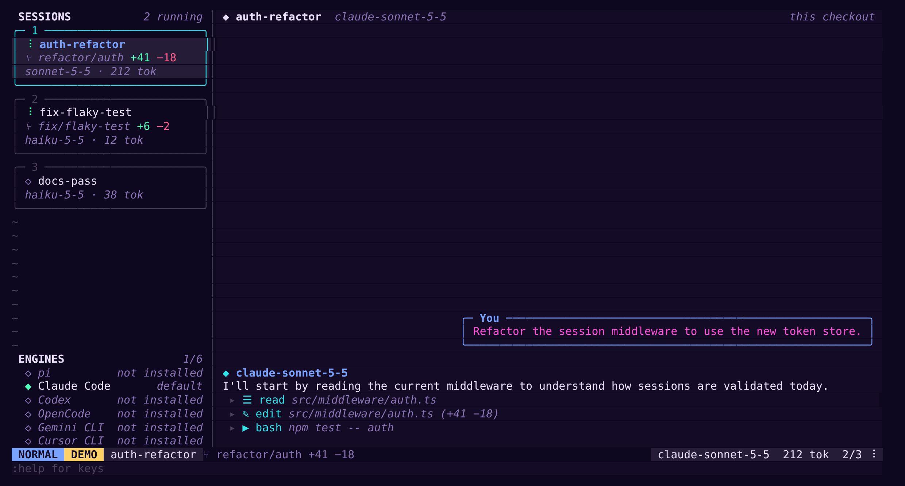
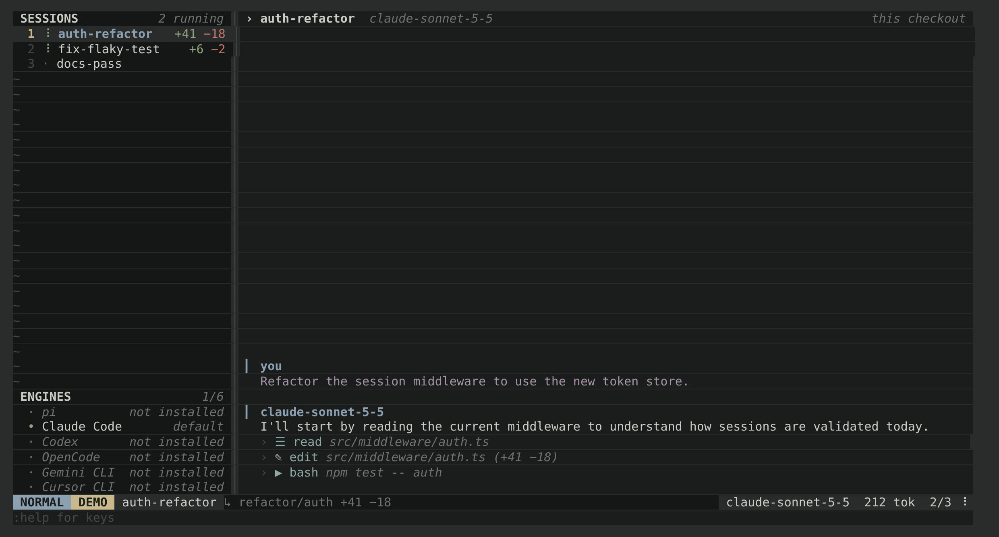
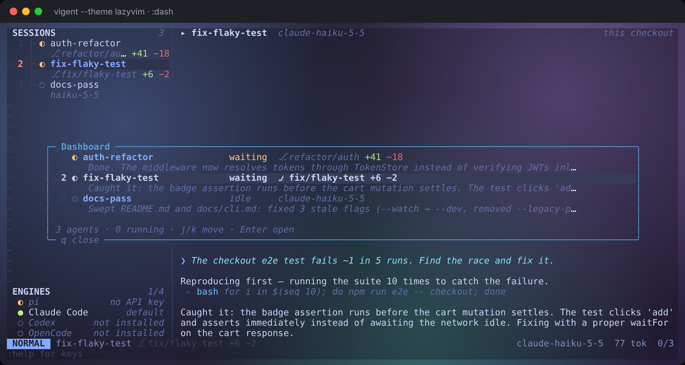

# Themes and customization

vigent uses **Neovim's highlight group names** (`Normal`, `StatusLine`, `CursorLine`, `Visual`, `Comment`, `DiffAdd`, …) for every color it draws. Any vim or Neovim colorscheme maps onto vigent directly, and anything you already know about `:highlight` works here too.

## Quick reference

| I want to… | Do this |
|---|---|
| Use my Neovim/Vim theme | `vigent theme import` (reads whatever your editor config uses) |
| Use a specific vim/nvim colorscheme | `vigent theme import tokyonight` |
| Use a `.vim` colorscheme file | `vigent theme import ./molokai.vim` (no editor needed) |
| Pick a theme interactively | `:colorscheme` or `<Space>t` (live preview, with each theme's colors) |
| Change theme, options and keys in one place | `:settings` or `<Space>s`, then `w` to save them |
| Set my default theme | `theme = "…"` in `~/.config/vigent/config.toml` |
| Tweak a few colors | `[highlights]` in config.toml, or `:hi Group guifg=… guibg=…` |
| Make my own theme | `vigent theme new mytheme --from tokyonight` (pre-filled with its colors) |
| Keep the colors I tweaked live | `:theme save mytheme` |
| See my terminal's background (blur, wallpaper) | `vigent --theme lazyvim`, or `:set transparent` with any theme |

Files live in `~/.config/vigent/` (or `$XDG_CONFIG_HOME/vigent/`). `vigent theme path` prints the exact location.

## Built-in themes

27 of them, dark and light:

| | |
|---|---|
| Neovim | `default` (Neovim's own), `lazyvim` (LazyVim's look, transparent) |
| tokyonight | `tokyonight`, `tokyonight-storm`, `tokyonight-moon` |
| catppuccin | `catppuccin` (mocha), `catppuccin-macchiato`, `catppuccin-frappe`, `catppuccin-latte` (light) |
| rose-pine | `rose-pine`, `rose-pine-moon`, `rose-pine-dawn` (light) |
| GitHub | `github-dark`, `github-light` (light) |
| solarized | `solarized-dark`, `solarized-light` (light) |
| more | `gruvbox`, `kanagawa`, `nord`, `dracula`, `onedark`, `everforest`, `nightfox`, `monokai-pro`, `ayu-mirage` |
| with a layout of their own | `neon` (cards, chat bubbles), `zen` (compact rows, labeled messages); see [Styles](#styles-layout-and-icons) |

`:colorscheme` (or `<Space>t`) opens a picker that shows each theme's colors and whether it's dark, light or transparent, and previews the one under the cursor live. Type to filter, Enter keeps it, Esc goes back.

`lazyvim` is the look LazyVim starts with: tokyonight's "moon" palette with its highlight choices (orange current line number, blue rounded float borders, cyan italic keywords, blue / green / magenta / yellow mode badges), drawn on the terminal's own background. `tokyonight-moon` is the same theme with solid backgrounds.

## Styles: layout and icons

A theme can change how vigent is laid out, not only its colors: the sidebar, how messages look, and any icon. That part is its **style**, a `[style]` table in the theme file. `[style]` in config.toml sets the same things over whatever the theme says, so you can pair any colors with any layout.

```toml
[style]
sidebar = "cards"          # tree (default), cards, compact
messages = "bubbles"       # plain (default), labeled, bubbles
tool_icons = "unicode"     # none, unicode, nerd (default: nerd with icons = "nerd", else none)
user_label = "you"         # what labeled and bubble messages call you (default "You")

[style.icons]              # replace any glyph
prompt = "λ "
worktree = "⑂ "
idle = "◇"                 # agent states: idle, waiting, paused, error
```

| Option | Choices |
|---|---|
| `sidebar` | `tree`: neo-tree's look, a branch line under each agent. `cards`: a box per agent with its branch, changes, model and tokens. `compact`: one row per agent, the `+/-` counts at the right |
| `messages` | `plain`: `❯` before your prompts. `labeled`: a header over each message (you, or the engine's name) with the text indented under it. `bubbles`: your prompts in a box at the right, like a chat; replies named by their engine |
| `tool_icons` | an icon before each tool call: `unicode` (▶ shell, ✎ edit, ☰ read, ⌕ search, ◍ web, ☑ plan, ⚙ other) works in any font; `nerd` needs a Nerd Font |
| `icons` | `prompt`, `worktree`, `folded`, `open`, `cursor`, `bullet`, `queued`, `open_agent`, `here`, `unread`, `light`, `ok`, `warn`, `off`, `sep`, and the agent states `idle`, `waiting`, `paused`, `error` |

`:settings` (`<Space>s`) cycles the sidebar and message styles and saves them to `[style]`. `:colorscheme` previews a theme's layout along with its colors.

The built-in `neon` and `zen` show what a style does:





To make your own, extend one and change what you like (see [Writing your own theme](#writing-your-own-theme)):

```toml
# ~/.config/vigent/themes/mine.toml
extends = "tokyonight"     # its colors
[style]
sidebar = "cards"
messages = "labeled"
tool_icons = "unicode"
[style.icons]
prompt = "λ "
```

## Transparent backgrounds

A transparent theme leaves the background to your terminal, so a translucent or blurred terminal, or one with a wallpaper, shows through vigent. These groups use the terminal's background: `Normal`, the sidebar, floats and their borders, the statusline, the winbar, line numbers and separators, plus any group that only repeated `Normal`'s background. Selections (`Visual`), the cursorline, search matches, popup menus and the mode badges keep their colors, so you can still see where you are.

```vim
:set transparent        " with any theme
:set notransparent      " solid, even for a transparent theme like lazyvim
:set transparent!       " toggle what's on screen
:set transparent&       " back to what the theme says
```

To keep it, set `transparent = true` under `[ui]` in config.toml (every theme), or in a theme file (that theme). A theme that `extends` a transparent one is transparent too, unless it says `transparent = false`.



## Importing vim and Neovim colorschemes

```bash
vigent theme import                     # the colorscheme your nvim (or vim) config sets
vigent theme import catppuccin-frappe   # any colorscheme your editor can load
vigent theme import gruvbox-material --as gm
vigent theme import ./colors/molokai.vim
```

vigent runs your editor headless with your normal config, so colorschemes installed with lazy.nvim, packer, vim-plug or native packages load the same way they do when you edit. It then saves every resolved highlight group to `~/.config/vigent/themes/<name>.json`. If loading with your config fails, it retries with a clean editor (`--clean`), and then with the other editor.

Options:

| Flag | Meaning |
|---|---|
| `--as <name>` | save under a different name |
| `--nvim`, `--vim` | use only this editor (default: try nvim, then vim) |
| `--light`, `--dark` | set `'background'` first, for themes with both variants |
| `--clean` | skip your editor config (faster; plugin-installed themes won't load) |

Requirements: Neovim 0.9+ or Vim 9+ for the most accurate import. Older versions still work through their `:highlight` listing. Without either editor, `.vim` files are read directly. That covers the classic `hi Group guifg=… guibg=…` style, including `&background` branches and links. Themes written in Lua, or built with functions at runtime, need nvim.

Terminal-only themes (only `ctermfg`/`ctermbg`) are converted with the standard xterm-256 palette. Vim color names (`LightBlue`, `grey40`, …) are converted to hex.

Groups a theme doesn't define fall back the way Neovim's do, so a partial theme still looks complete. vigent's own groups are derived from the theme when it doesn't set them:

- **Mode badges** take their color from `Function`, `String`, `Statement` and `WarningMsg`.
- **Sidebar** uses `NeoTreeNormal` or `NvimTreeNormal` if the theme styles them, otherwise a slightly darker `Normal` background.

## Inside vigent

```vim
:colorscheme                 " floating picker: type to filter, ↑/↓ or Ctrl-n/Ctrl-p preview, Enter keeps, Esc cancels
:colorscheme nord            " switch directly (also :colo, :theme)
:hi Comment guifg=#7a88cf gui=italic
:hi VigentModeNormal guibg=#ebcb8b guifg=#2e3440 gui=bold
:hi link VigentUser String
:hi Normal                   " show a group, like vim: Normal xxx guifg=… guibg=…
:hi clear Comment            " undo your change to one group (:hi clear undoes all)
```

`:hi` accepts vim's keys (`guifg`, `guibg`, `gui`, `ctermfg`, `ctermbg`, `cterm`), the shorter `fg=`/`bg=`, and bare attributes like `bold`. Your `:hi` changes stay in place when you switch colorschemes. They last until you quit; put them in config.toml to keep them.

## config.toml

`vigent config init` writes a commented starter file. Keys, leader and every other setting are covered in [config.md](config.md).

```toml
theme = "tokyonight"

[ui]
sidebar = true
sidebar_width = 30
number = true        # session numbers in the sidebar
tilde = true         # ~ on empty sidebar rows
icons = "unicode"    # "ascii" for fonts without box-drawing characters

# Applied on top of whichever theme is active, including after :colorscheme.
[highlights]
Normal = { bg = "NONE" }                  # transparent: use the terminal's background
CursorLine = "guibg=#2a2f3a"              # vim :hi syntax works too
VigentSidebar = "NormalFloat"             # a bare name links to that group
VigentModeInsert = { fg = "#1a1b26", bg = "#9ece6a", bold = true }
```

Unlike `nvim_set_hl`, an override **merges** with the theme's definition. `Normal = { bg = "NONE" }` keeps the theme's foreground and only drops the background. Use `"NONE"` for either color to fall through to the terminal's own color.

Mistakes in the config never stop vigent from starting. They show up as a warning on the command line instead.

The UI options can also be changed live with vim-style `:set`:

```vim
:set nonumber       :set number!       :set notilde
:set sidebar_width=40                  :set icons=ascii
:set                " show all options
```

## Writing your own theme

There are two quick ways in.

**From the command line**, start a file from any theme:

```bash
vigent theme new midnight --from tokyonight     # extends tokyonight; its palette is in the file, commented out
vigent theme new midnight --from lazyvim --palette       # built from the palette alone: edit 8 colors, get a whole theme
vigent theme new glass --from nord --transparent         # nord on the terminal's background
```

The file it writes (`~/.config/vigent/themes/midnight.toml`) is commented and already holds the base theme's real colors: background, text, the six accents, and the optional sidebar, cursorline, selection, comment and line-number colors. Change a few, then `:colorscheme midnight` (the picker previews it live).

**From inside vigent**, tweak colors with `:hi` and `:set transparent` until you like what you see, then:

```vim
:theme save midnight     " ~/.config/vigent/themes/midnight.toml, and switch to it
:theme save! midnight    " overwrite it after more tweaks
```

On top of a built-in theme the saved file stays small: `extends` plus only the groups you changed. Saved from one of your own themes, it holds every group, so it never depends on the file it replaces. Make it your default with `theme = "midnight"` in config.toml.

A theme file can do any combination of these:

**Extend** another theme and change a few groups:

```toml
extends = "tokyonight"

[groups]
Normal = { bg = "#0f0f17" }
VigentSidebar = { bg = "#0a0a10" }
CursorLineNr = "Title"
```

**Use the terminal's background** (see [Transparent backgrounds](#transparent-backgrounds)):

```toml
extends = "kanagawa"
transparent = true
```

**Describe a palette** and let vigent derive every group from it. Only `bg`, `fg` and the six accents are required. With `extends` as well, the palette recolors the base theme, and `[groups]` still wins over both:

```toml
name = "midnight"

[palette]
bg = "#0b0e14"
fg = "#bfbdb6"
red = "#f07178"
yellow = "#ffb454"
green = "#aad94c"
cyan = "#95e6cb"
blue = "#59c2ff"
magenta = "#d2a6ff"
# optional: bg_dark (sidebar), bg_alt (cursorline/statusline), selection,
#           muted (comments), subtle (line numbers), orange, accent
```

**List groups** explicitly, as a table, a `:hi` string, or a link name:

```toml
[groups]
Normal = { fg = "#e0e2ea", bg = "#14161b" }
Comment = "guifg=#9b9ea4 gui=italic"
WinSeparator = "NonText"
```

JSON works too (`midnight.json` with the same keys), and so does a plain `.vim` colorscheme dropped into the themes folder.

## Highlight groups vigent uses

Standard Neovim groups: `Normal`, `NormalFloat`, `FloatBorder`, `FloatTitle`, `StatusLine`, `StatusLineNC`, `WinBar`, `WinSeparator`, `CursorLine`, `CursorLineNr`, `LineNr`, `EndOfBuffer`, `NonText`, `Comment`, `Title`, `Keyword`, `Function`, `String`, `Search`, `Visual`, `Pmenu`, `PmenuSel`, `ErrorMsg`, `WarningMsg`, `ModeMsg`, `MsgArea`.

Tree-plugin groups (picked up from imported themes): `NeoTreeNormal`, `NvimTreeNormal`, `NeoTreeIndentMarker`, `NvimTreeIndentMarker`.

vigent's own groups:

| Group | Used for | Default |
|---|---|---|
| `VigentSidebar` | sidebar background | `NeoTreeNormal` → `NvimTreeNormal` → shaded `Normal` |
| `VigentIndent` | sidebar tree guides | `NeoTreeIndentMarker` → `NonText` |
| `VigentModeNormal`, `VigentModeInsert`, `VigentModeVisual`, `VigentModeCommand` | statusline mode badge | derived from `Function` / `String` / `Statement` / `WarningMsg` |
| `VigentUser` | the `❯` before your prompts | `Title` |
| `VigentMention` | `@path` file mentions in your prompts | `Directory` |
| `VigentTool` | tool names in the transcript | `Function` |
| `VigentToolOutput` | unfolded tool output | `Comment` |
| `VigentSpinner` | running indicator | `WarningMsg` |
